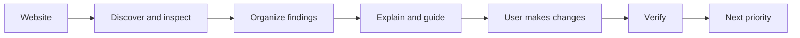
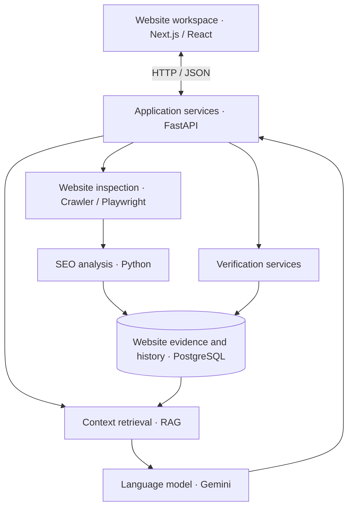

# Aravind Mugappagari

**Product Builder · Software Systems & Applied AI**

My work brings together analytical thinking, business understanding and technical execution. I identify underlying problems, evaluate opportunities, define practical strategies and turn complex requirements into structured solutions. My approach emphasizes informed decisions, clear communication and measurable outcomes.

[LinkedIn](https://www.linkedin.com/in/aravindmugappagari) · [GitHub repositories](https://github.com/aravind9154?tab=repositories)

---

# C O P L I T

**AI-powered SEO intelligence**

### From website diagnostics to informed action.

[Product overview](https://github.com/aravind9154/COPLIT-Portfolio) · [System architecture](https://github.com/aravind9154/COPLIT-Portfolio/blob/main/ARCHITECTURE.md)

### The problem

Search engine optimization (SEO) helps websites become discoverable through search engines. A technical website audit can reveal hundreds of issues. For a business owner without specialist knowledge, the difficult part is deciding which issues matter, understanding their impact and knowing how to resolve them.

Studying the audit workflows of Semrush, Ahrefs and Screaming Frog led me to focus on what happens after a problem is reported. COPLIT is designed around that gap. It connects website inspection, evidence-based explanations, prioritized recommendations and verification within a single workflow.

### A closer look

For a missing page heading, COPLIT's workflow connects affected pages, an explanation, a suggested correction and an independent recheck. [See the product experience](https://github.com/aravind9154/COPLIT-Portfolio/blob/main/PRODUCT-CASE-STUDY.md).

---

## Behind the product

| My contribution | Focus |
|---|---|
| Product design | Research, requirements and guided resolution |
| System design | API, crawler and evidence storage responsibilities |
| Applied AI | Website-specific context and independent verification |
| Engineering | Request deadlines, database behavior and testing |

### System design

Logical architecture; see [validation](https://github.com/aravind9154/COPLIT-Portfolio/blob/main/VALIDATION-AND-LIMITATIONS.md) for tested behavior and integration boundaries.

## Explore COPLIT

| Documentation | What you will find |
| :--- | :--- |
| **[Product research & design](https://github.com/aravind9154/COPLIT-Portfolio/blob/main/PRODUCT-CASE-STUDY.md)** | Market problem, user needs, product decisions and experience design |
| **[Software architecture](https://github.com/aravind9154/COPLIT-Portfolio/blob/main/ARCHITECTURE.md)** | Technology choices, API contracts, database relationships, crawling and security |
| **[AI intelligence](https://github.com/aravind9154/COPLIT-Portfolio/blob/main/AI-INTELLIGENCE.md)** | LLMs, Gemini, RAG, context retrieval and evidence-based responses |
| **[Engineering case studies](https://github.com/aravind9154/COPLIT-Portfolio/blob/main/ENGINEERING-CASE-STUDIES.md)** | Technical investigations, debugging, failure handling and verification |
| **[Validation & reliability](https://github.com/aravind9154/COPLIT-Portfolio/blob/main/VALIDATION-AND-LIMITATIONS.md)** | Recorded tests, supported behavior and engineering limitations |

---

## Additional work

**[AI-powered SEO content research](https://github.com/aravind9154/100hires-growth-marketing-task)**

An investigation into how SEO practitioners use AI for content creation, supported by structured research, analysis and Python-based automation.

---

## Connect

I am interested in opportunities that combine user understanding, software systems and technical problem-solving. [Connect with me on LinkedIn](https://www.linkedin.com/in/aravindmugappagari).
