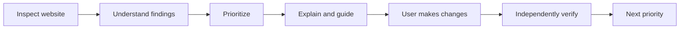
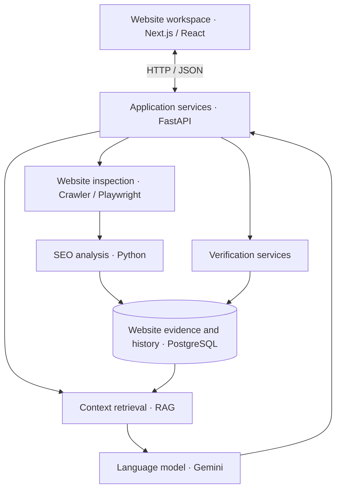

# Aravind Mugappagari

**Product Builder · Software Systems & Applied AI**

My work brings together analytical thinking, business understanding and technical execution. I identify underlying problems, evaluate opportunities, define practical strategies and turn complex requirements into structured solutions. My approach emphasizes informed decisions, clear communication and measurable outcomes.

[LinkedIn](https://www.linkedin.com/in/aravindmugappagari) · [GitHub repositories](https://github.com/aravind9154?tab=repositories)

---

# C O P L I T

**AI-powered SEO intelligence**

### From website diagnostics to informed action.

COPLIT is an AI-powered platform designed to help website owners identify technical problems, understand their impact, prioritize corrections and verify whether those corrections work.

[Product overview](https://github.com/aravind9154/COPLIT-Portfolio) · [System architecture](https://github.com/aravind9154/COPLIT-Portfolio/blob/main/ARCHITECTURE.md)

### The problem

Search engine optimization (SEO) helps websites become discoverable through search engines. A technical website audit can reveal hundreds of issues. For a business owner without specialist knowledge, the difficult part is deciding which issues matter, understanding their impact and knowing how to resolve them.

Studying the audit workflows of Semrush, Ahrefs and Screaming Frog led me to focus on what happens after a problem is reported. COPLIT is designed around that gap. Its distinguishing design focus is guided resolution: connecting each finding to website evidence, practical guidance and an independent recheck, rather than treating the audit report as the end of the user's work.

### A closer look

For a missing page heading, COPLIT's workflow connects affected pages, an explanation, a suggested correction and an independent recheck. [See the product experience](https://github.com/aravind9154/COPLIT-Portfolio/blob/main/PRODUCT-CASE-STUDY.md).

---

## Behind the product

| Professional capability | How I applied it in COPLIT |
|---|---|
| Research & business judgment | Examined existing audit workflows and focused on the difficulty of turning findings into corrections. |
| Decision-making & prioritization | Chose guided problem resolution over reproducing an entire SEO suite; balanced inspection coverage with resource limits. |
| Product & system design | Translated user needs into requirements, application workflows, API responsibilities and evidence storage. |
| Technical problem-solving | Traced request failures across services and database operations; coordinated AI-assisted corrections and evaluated test results. |
| Quality & risk management | Separated AI explanations from independent verification to avoid treating generated advice as proof. |
| Communication | Translated technical findings into practical guidance and documented system decisions and engineering outcomes. |

My approach is to understand the problem, compare possible solutions, define priorities, coordinate execution and evaluate the outcome against the original requirement.

**Engineering outcome:** A local audit identified missing main headings (H1) and missing meta descriptions. After corrections, independent rechecks confirmed both findings were fixed and the workflow advanced to the next priority. Offline reliability checks also evaluated request deadlines, database timeouts and rollback behavior. [See what was tested](https://github.com/aravind9154/COPLIT-Portfolio/blob/main/VALIDATION-AND-LIMITATIONS.md). [Explore the engineering investigation](https://github.com/aravind9154/COPLIT-Portfolio/blob/main/ENGINEERING-CASE-STUDIES.md#3-checking-whether-a-fix-worked).

### System design

Logical architecture; see [validation](https://github.com/aravind9154/COPLIT-Portfolio/blob/main/VALIDATION-AND-LIMITATIONS.md) for tested behavior and integration boundaries.

## Explore COPLIT

| Documentation | What you will find |
| :--- | :--- |
| **[Product research & design](https://github.com/aravind9154/COPLIT-Portfolio/blob/main/PRODUCT-CASE-STUDY.md)** | Market problem, user needs, product decisions and experience design |
| **[Software architecture](https://github.com/aravind9154/COPLIT-Portfolio/blob/main/ARCHITECTURE.md)** | Technology choices, API contracts, database relationships, crawling and security |
| **[AI intelligence](https://github.com/aravind9154/COPLIT-Portfolio/blob/main/AI-INTELLIGENCE.md)** | LLMs, Gemini, RAG, context retrieval and evidence-based responses |
| **[Engineering case studies](https://github.com/aravind9154/COPLIT-Portfolio/blob/main/ENGINEERING-CASE-STUDIES.md)** | Technical investigations, debugging, failure handling and verification |
| **[Validation & reliability](https://github.com/aravind9154/COPLIT-Portfolio/blob/main/VALIDATION-AND-LIMITATIONS.md)** | Recorded tests, supported behavior and engineering limitations |

---

## Additional work

**[AI-powered SEO content research](https://github.com/aravind9154/100hires-growth-marketing-task)**

An investigation into how SEO practitioners use AI for content creation, supported by structured research, analysis and Python-based automation.

---

## Connect

Open to opportunities where analytical thinking, business understanding and technical capabilities can contribute to meaningful outcomes. [Connect with me on LinkedIn](https://www.linkedin.com/in/aravindmugappagari).
