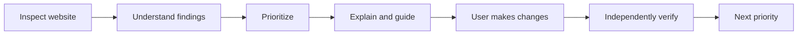
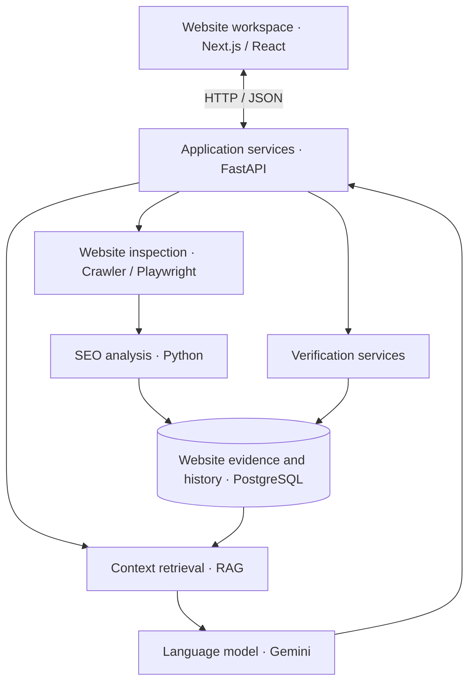

# Aravind Mugappagari

**Product Builder · Software Systems & Applied AI**

My work brings together analytical thinking, business understanding and technical execution. I identify underlying problems, evaluate opportunities, define practical strategies and turn complex requirements into structured solutions. My approach emphasizes informed decisions, clear communication and measurable outcomes.

[LinkedIn](https://www.linkedin.com/in/aravindmugappagari) · [GitHub repositories](https://github.com/aravind9154?tab=repositories)

---

# C O P L I T

**AI-powered SEO intelligence**

### From website diagnostics to informed action.

COPLIT is an AI-powered platform designed to help website owners identify technical problems, understand their impact, prioritize corrections and verify whether those corrections work.

[Product overview](https://github.com/aravind9154/COPLIT-Portfolio) · [System architecture](https://github.com/aravind9154/COPLIT-Portfolio/blob/main/ARCHITECTURE.md)

## Research & Problem Discovery

My work in search intelligence began with SearchCraft Lab, where I explored SEO through content research, website optimization and individual SEO tools. Working with indexing, metadata and internal linking led me to investigate a broader problem: how can website owners turn technical findings into practical decisions?

My research into [Semrush](https://www.semrush.com/), [Ahrefs](https://ahrefs.com/) and [Screaming Frog](https://www.screamingfrog.co.uk/seo-spider/) focused on the relationship between technical diagnostics and the decisions users make after receiving an audit.

| Research observation | Product decision |
|---|---|
| Similar issues can affect many pages. | Group related findings while retaining page-level evidence. |
| A list of issues does not necessarily establish where a user should begin. | Prioritize problems and explain their relevance. |
| A recommendation alone cannot establish whether a correction worked. | Connect guidance with independent verification. |
| Website optimization involves repeated inspections and corrections. | Preserve findings and resolution history. |

Rather than reproduce a general-purpose SEO suite, I chose to concentrate on the journey from identifying a problem to resolving it. The intended users are website owners, freelancers and small agencies who need to make informed decisions from technical information.

For example, when a page is missing its main heading, COPLIT connects the finding to the affected page, explains its relevance, guides the user toward a correction and independently reinspects the page after the change. [See the product experience](https://github.com/aravind9154/COPLIT-Portfolio/blob/main/PRODUCT-CASE-STUDY.md).

---

## Product & Engineering Strategy

The architecture follows a central product requirement: explanations must be connected to observable website information, and a suggested correction must not be mistaken for a verified result. This shapes how inspection, data storage, application services and AI are separated.

**Architecture rationale**

- **Next.js, React and FastAPI:** Separate the interactive workspace from Python-based inspection and analysis through defined API contracts.
- **Custom crawler and Playwright:** Combine HTTP inspection with browser-rendered content where JavaScript affects what a page contains, while controlling inspection costs.
- **PostgreSQL:** Preserve relationships between websites, audits, affected pages, findings, evidence and verification history.
- **LLM and retrieval architecture:** Use relevant website context to inform explanations, rather than depend on model knowledge alone. Keep verification independent of generated text.

These choices balance inspection depth, traceability, resource consumption and the need for a clear user experience. [Architecture and design trade-offs](https://github.com/aravind9154/COPLIT-Portfolio/blob/main/ARCHITECTURE.md).

## Technical Documentation

| Documentation | Scope |
|---|---|
| **[Product research & design](https://github.com/aravind9154/COPLIT-Portfolio/blob/main/PRODUCT-CASE-STUDY.md)** | Market problem, user needs and product decisions. |
| **[Software architecture](https://github.com/aravind9154/COPLIT-Portfolio/blob/main/ARCHITECTURE.md)** | Technology choices, APIs, data relationships, crawling and security. |
| **[AI intelligence](https://github.com/aravind9154/COPLIT-Portfolio/blob/main/AI-INTELLIGENCE.md)** | Language models, context retrieval and evidence-based responses. |
| **[Engineering case studies](https://github.com/aravind9154/COPLIT-Portfolio/blob/main/ENGINEERING-CASE-STUDIES.md)** | Technical investigations, debugging and verification. |
| **[Validation & reliability](https://github.com/aravind9154/COPLIT-Portfolio/blob/main/VALIDATION-AND-LIMITATIONS.md)** | Test methods and recorded engineering results. |

---

## Independent Research

**[AI-powered SEO content production](https://github.com/aravind9154/100hires-growth-marketing-task)**

A structured research assignment examining how experienced SEO practitioners approach AI-assisted content creation, semantic SEO, search quality and content automation.

I selected 10 practitioners, reviewed material published between April and June 2026, organized LinkedIn and YouTube research by author, and synthesized common themes. The repository includes a Python transcript-collection utility alongside the research methodology and source records.

**Research methodology:** [Selection and collection process](https://github.com/aravind9154/100hires-growth-marketing-task/blob/main/research/methodology.md) · [Source references](https://github.com/aravind9154/100hires-growth-marketing-task/blob/main/research/sources.md) · [Common themes](https://github.com/aravind9154/100hires-growth-marketing-task/blob/main/research/other/ai-seo-common-themes.md)

---

## Professional Contribution

As the independent product developer behind COPLIT, I take responsibility for the decisions connecting the original problem to the software solution.

- **Product ownership:** Define the problem, intended users, requirements, priorities and boundaries of the solution.
- **Analytical judgment:** Compare approaches, identify trade-offs and translate research into specific product decisions.
- **Technical execution:** Coordinate AI-assisted development, review application behavior, trace failures across service boundaries and evaluate proposed corrections.
- **Quality and communication:** Define expected behavior, assess results against requirements and document technical decisions so they can be understood and reviewed.

My contribution is not limited to producing code or documenting a product. It includes deciding what should be built, why it matters, how its components should work together and how to evaluate whether the solution meets its intended purpose.

[LinkedIn](https://www.linkedin.com/in/aravindmugappagari) · [GitHub repositories](https://github.com/aravind9154?tab=repositories)
