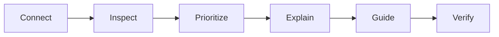
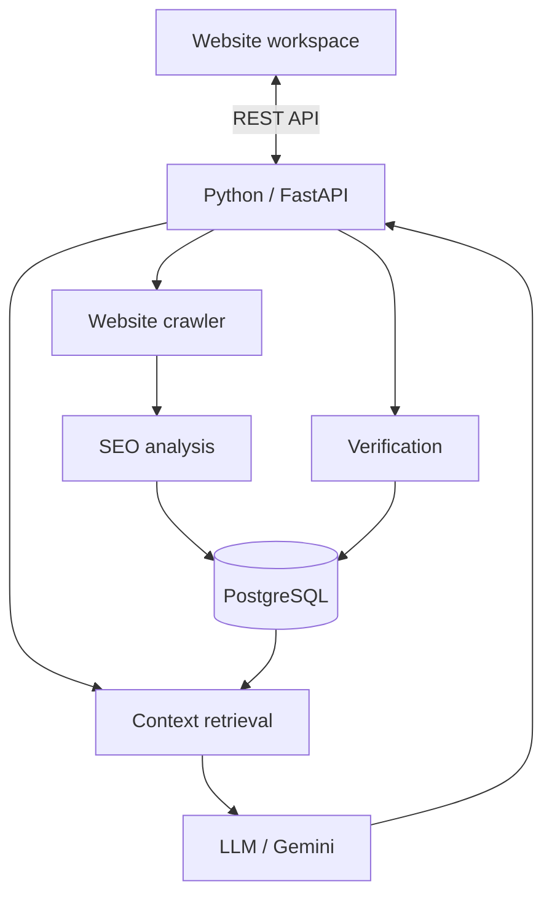

# Aravind Mugappagari

**Product Development · Software Architecture · Applied AI**

My work combines product research, software design and AI-assisted development. I focus on understanding user problems, designing how software should solve them, and investigating how the system behaves when things go wrong.

## COPLIT

### Understand your website. Know what to fix.

COPLIT is an AI-powered SEO platform designed to help website owners understand technical problems, decide what to address first and check whether their changes worked.

SEO tools provide detailed website audits. COPLIT focuses on what happens next: turning technical findings into clear explanations and practical steps.

| Website analysis | AI assistance | Verification |
| :--- | :--- | :--- |
| Discover pages, identify problems and organize findings. | Explain problems using website information and guide the user towards a solution. | Check supported problems again after the user makes changes. |

[Explore COPLIT →](https://github.com/aravind9154/COPLIT-Portfolio)

### How the system fits together

*System design overview.*

### Explore the work

| Area | Inside |
| :--- | :--- |
| [Product research and design](https://github.com/aravind9154/COPLIT-Portfolio/blob/main/PRODUCT-CASE-STUDY.md) | User problems, existing solutions, product decisions and workflows |
| [Software architecture](https://github.com/aravind9154/COPLIT-Portfolio/blob/main/ARCHITECTURE.md) | Frontend, backend, API communication, databases, crawling and security |
| [AI and information retrieval](https://github.com/aravind9154/COPLIT-Portfolio/blob/main/AI-INTELLIGENCE.md) | LLMs, Gemini, RAG and website-specific explanations |
| [Technical investigations](https://github.com/aravind9154/COPLIT-Portfolio/blob/main/ENGINEERING-CASE-STUDIES.md) | API failures, debugging, timeouts, error handling and verification |
| [Engineering tests](https://github.com/aravind9154/COPLIT-Portfolio/blob/main/VALIDATION-AND-LIMITATIONS.md) | Test results, system behavior and limitations |

**Technology:** Next.js · React · TypeScript · Tailwind CSS · Python · FastAPI · PostgreSQL · Playwright · REST APIs · LLM · RAG

## Other work

[AI-powered SEO content research](https://github.com/aravind9154/100hires-growth-marketing-task) — Research into how practitioners use AI for SEO content, supported by structured analysis and automation.

[LinkedIn](https://www.linkedin.com/in/aravindmugappagari) · [Repositories](https://github.com/aravind9154?tab=repositories)
