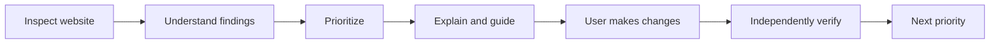
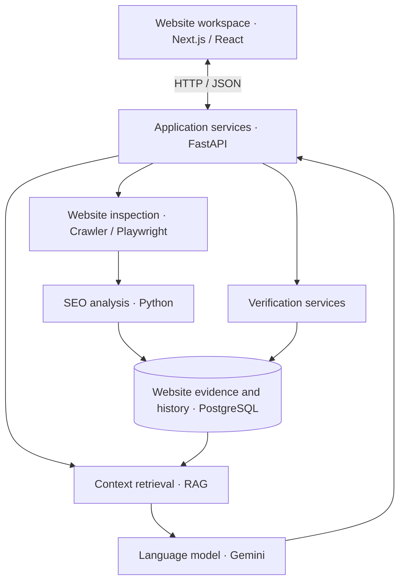

# Aravind Mugappagari

**Product Builder · Software Systems & Applied AI**

My work brings together analytical thinking, business understanding and technical execution. I identify underlying problems, evaluate opportunities, define practical strategies and turn complex requirements into structured solutions. My approach emphasizes informed decisions, clear communication and measurable outcomes.

[LinkedIn](https://www.linkedin.com/in/aravindmugappagari) · [GitHub repositories](https://github.com/aravind9154?tab=repositories)

---

# C O P L I T

**AI-powered SEO intelligence**

### From website diagnostics to informed action.

COPLIT is an AI-powered platform designed to help website owners identify technical problems, understand their impact, prioritize corrections and verify whether those corrections work.

[Product overview](https://github.com/aravind9154/COPLIT-Portfolio) · [System architecture](https://github.com/aravind9154/COPLIT-Portfolio/blob/main/ARCHITECTURE.md)

## Research & Problem Discovery

My work in search intelligence began with SearchCraft Lab, where I explored SEO through content research, website optimization and individual SEO tools. Working with indexing, metadata and internal linking led me to investigate a broader problem: how can website owners turn technical findings into practical decisions?

I studied the audit workflows of [Semrush](https://www.semrush.com/), [Ahrefs](https://ahrefs.com/) and [Screaming Frog](https://www.screamingfrog.co.uk/seo-spider/). Their approaches to website diagnostics helped me distinguish between discovering a problem and supporting its resolution.

**My observation:** A technical audit can identify numerous issues, but a website owner must still understand their significance, determine priorities, identify affected pages and evaluate corrections. I chose to focus on that decision-making journey rather than reproduce an entire SEO suite.

COPLIT connects website evidence, explanations, practical guidance and independent verification around that objective.

For example, when a page is missing its main heading, COPLIT connects the finding to the affected page, explains its relevance, guides the user toward a correction and independently reinspects the page after the change. [See the product experience](https://github.com/aravind9154/COPLIT-Portfolio/blob/main/PRODUCT-CASE-STUDY.md).

---

## Product & Engineering Strategy

I translate research observations into product requirements, define priorities and evaluate alternative approaches before coordinating AI-assisted development. For COPLIT, that meant balancing website inspection coverage with resource limits and separating evidence collection, language intelligence and verification into distinct responsibilities.

Logical architecture; see [validation](https://github.com/aravind9154/COPLIT-Portfolio/blob/main/VALIDATION-AND-LIMITATIONS.md) for tested behavior and integration boundaries.

The application services coordinate website inspection and data operations. Stored website evidence supplies context for explanations, while independent verification evaluates corrections without treating AI-generated advice as proof.

My contribution includes defining the product experience, establishing system responsibilities, tracing failures across application and database layers, evaluating corrections and documenting technical decisions. These are transferable approaches to investigating unfamiliar problems, translating requirements into practical solutions and assessing outcomes.

## Engineering Validation & Outcomes

A local audit identified missing main headings (H1) and missing meta descriptions. After corrections, independent rechecks confirmed both findings were fixed and the workflow advanced to the next priority. Offline reliability checks also evaluated request deadlines, database timeouts and rollback behavior. [See what was tested](https://github.com/aravind9154/COPLIT-Portfolio/blob/main/VALIDATION-AND-LIMITATIONS.md). [Engineering case study](https://github.com/aravind9154/COPLIT-Portfolio/blob/main/ENGINEERING-CASE-STUDIES.md).

## Technical Documentation

| Documentation | Scope |
|---|---|
| **[Product research & design](https://github.com/aravind9154/COPLIT-Portfolio/blob/main/PRODUCT-CASE-STUDY.md)** | Market problem, user needs and product decisions. |
| **[Software architecture](https://github.com/aravind9154/COPLIT-Portfolio/blob/main/ARCHITECTURE.md)** | Technology choices, APIs, data relationships, crawling and security. |
| **[AI intelligence](https://github.com/aravind9154/COPLIT-Portfolio/blob/main/AI-INTELLIGENCE.md)** | Language models, context retrieval and evidence-based responses. |
| **[Engineering case studies](https://github.com/aravind9154/COPLIT-Portfolio/blob/main/ENGINEERING-CASE-STUDIES.md)** | Technical investigations, debugging and verification. |
| **[Validation & reliability](https://github.com/aravind9154/COPLIT-Portfolio/blob/main/VALIDATION-AND-LIMITATIONS.md)** | Test methods and recorded engineering results. |

---

## Independent Research

**[AI-powered SEO content research](https://github.com/aravind9154/100hires-growth-marketing-task)**

An investigation into how SEO practitioners use AI for content creation, supported by structured research, analysis and Python-based automation.

---

Open to opportunities where analytical thinking, business understanding and technical capabilities can contribute to meaningful outcomes. [Connect with me on LinkedIn](https://www.linkedin.com/in/aravindmugappagari).
