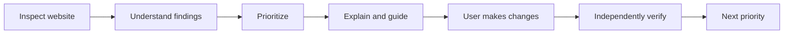
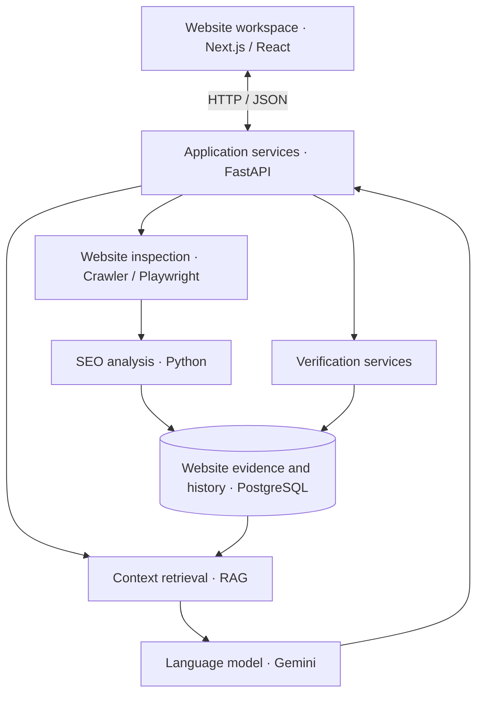

# Aravind Mugappagari

**Product Builder · Software Systems & Applied AI**

I work at the intersection of product research, software systems and applied AI. My work includes COPLIT, an SEO intelligence platform shaped by research into website audit workflows, and an independent study of AI-assisted content production across 10 SEO practitioners. I focus on translating research into product requirements, making reasoned technical decisions and evaluating software behavior against those requirements.

[LinkedIn](https://www.linkedin.com/in/aravindmugappagari) · [GitHub repositories](https://github.com/aravind9154?tab=repositories)

---

# C O P L I T

**AI-powered SEO intelligence**

### From website diagnostics to informed action.

COPLIT is an AI-powered SEO intelligence platform designed around the work that follows a website audit: deciding what matters, understanding why, making corrections and checking whether they worked. Its defining product principle is to connect every supported resolution workflow to website-specific evidence rather than rely on recommendations alone.

[Product overview](https://github.com/aravind9154/COPLIT-Portfolio) · [System architecture](https://github.com/aravind9154/COPLIT-Portfolio/blob/main/ARCHITECTURE.md)

## Research & Problem Discovery

My research into search engine optimization (SEO) began with content research, website optimization and technical checks such as indexing, metadata and internal linking. A website audit identifies issues that may affect how search engines access or understand pages. I became interested in what happens next: how can website owners turn those findings into practical decisions?

I examined the audit workflows of [Semrush](https://www.semrush.com/), [Ahrefs](https://ahrefs.com/) and [Screaming Frog](https://www.screamingfrog.co.uk/seo-spider/), focusing on issue discovery, severity, recommendations and reinspection. These are established capabilities; my product question was how to connect them into a guided experience for users without specialist SEO knowledge.

| Research observation | Product decision |
|---|---|
| Similar issues can affect many pages. | Group related findings while retaining page-level evidence. |
| A list of issues does not necessarily establish where a user should begin. | Prioritize problems and explain their relevance. |
| A recommendation alone cannot establish whether a correction worked. | Connect guidance with independent verification. |
| Website optimization involves repeated inspections and corrections. | Preserve findings and resolution history. |

I chose depth of guided resolution over the breadth of a general-purpose SEO suite. For website owners, the intended value is clearer decisions; for freelancers and small agencies, it is a more traceable way to explain and track website corrections. The product keeps website changes under the user's control.

Consider a website with missing main headings and meta descriptions across multiple pages. The product design groups related observations, retains the affected page details and helps the user work through prioritized findings. Corrections are checked against the relevant page condition, not against the AI's opinion. [See the product experience](https://github.com/aravind9154/COPLIT-Portfolio/blob/main/PRODUCT-CASE-STUDY.md).

---

## Product & Engineering Strategy

The architecture follows a central product requirement: explanations must be connected to observable website information, and a suggested correction must not be mistaken for a verified result. This shapes how inspection, data storage, application services and AI are separated.

The diagram presents the logical system design. **System design decisions**

- **Next.js, React and FastAPI:** Separate the interactive workspace from Python-based inspection and analysis through typed API contracts, so interface changes and backend operations have clear responsibilities.
- **Custom crawler and Playwright:** Combine HTTP inspection with browser-rendered content where JavaScript affects what a page contains, while controlling inspection costs.
- **PostgreSQL:** Preserve relationships between websites, audits, affected pages, findings and verification history, so a correction can be traced back to the observation that prompted it.
- **LLM and retrieval architecture:** The AI design retrieves relevant website context for explanations rather than relying on model knowledge alone. Dedicated checks remain responsible for verification.

These choices balance inspection depth, traceability, resource consumption and the need for a clear user experience. [Architecture and design trade-offs](https://github.com/aravind9154/COPLIT-Portfolio/blob/main/ARCHITECTURE.md).

## Technical Documentation

| Documentation | Scope |
|---|---|
| **[Product research & design](https://github.com/aravind9154/COPLIT-Portfolio/blob/main/PRODUCT-CASE-STUDY.md)** | Market problem, user needs and product decisions. |
| **[Software architecture](https://github.com/aravind9154/COPLIT-Portfolio/blob/main/ARCHITECTURE.md)** | Technology choices, APIs, data relationships, crawling and security. |
| **[AI intelligence](https://github.com/aravind9154/COPLIT-Portfolio/blob/main/AI-INTELLIGENCE.md)** | Language models, context retrieval and evidence-based responses. |
| **[Engineering case studies](https://github.com/aravind9154/COPLIT-Portfolio/blob/main/ENGINEERING-CASE-STUDIES.md)** | Technical investigations, debugging and verification. |
| **[Validation & reliability](https://github.com/aravind9154/COPLIT-Portfolio/blob/main/VALIDATION-AND-LIMITATIONS.md)** | Test methods and recorded engineering results. |

---

## Independent Research

**[AI-powered SEO content production](https://github.com/aravind9154/100hires-growth-marketing-task)**

A structured research assignment examining how experienced SEO practitioners approach AI-assisted content creation, semantic SEO, search quality and content automation.

I selected 10 practitioners, reviewed material published between April and June 2026, organized LinkedIn and YouTube research by author, and synthesized common themes. The repository includes a Python transcript-collection utility alongside the research methodology and source records.

**Research conclusion:** The synthesis identified recurring emphasis on semantic relationships, topical coverage, structured content workflows and human editorial review. AI is most useful as an efficiency tool when paired with expertise and fact-checking, rather than as a substitute for quality judgment.

**Research methodology:** [Selection and collection process](https://github.com/aravind9154/100hires-growth-marketing-task/blob/main/research/methodology.md) · [Source references](https://github.com/aravind9154/100hires-growth-marketing-task/blob/main/research/sources.md) · [Common themes](https://github.com/aravind9154/100hires-growth-marketing-task/blob/main/research/other/ai-seo-common-themes.md)

---

## Professional Contribution

I own COPLIT's product direction and coordinate its AI-assisted development. My responsibilities connect business requirements with engineering decisions:

- **Product definition:** Turned the interpretation burden of website audits into a guided resolution workflow, with explicit priorities, evidence and user control.
- **System design:** Defined the separation between inspection, stored evidence, contextual explanations and independent verification.
- **Technical investigation:** Traced request failures across application and database boundaries, reviewed proposed corrections and evaluated expected behavior.
- **Research and communication:** Organized practitioner research into actionable themes and documented product requirements, architecture, technical investigations and validation methods.

Across these projects, I bring a research-first approach to product decisions, structured technical investigation and the ability to communicate complex systems in terms of user needs.

[LinkedIn](https://www.linkedin.com/in/aravindmugappagari)
