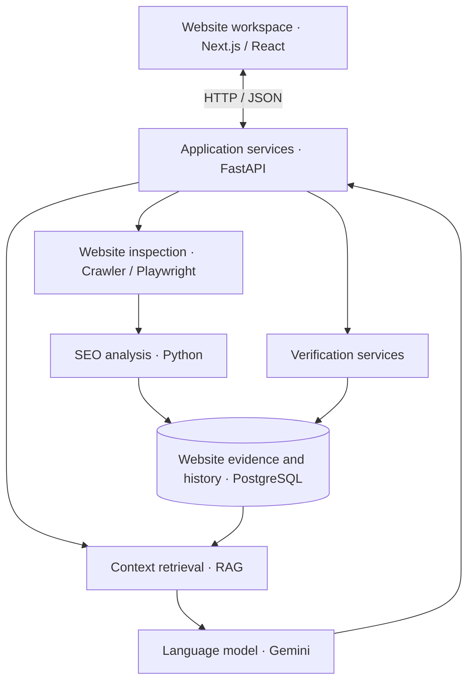

# Aravind Mugappagari

**Product Builder · Software Systems & Applied AI**

My work starts with understanding a user problem and ends with evaluating whether the software addresses it. Through COPLIT, I define product requirements, design application workflows and system boundaries, coordinate AI-assisted development, and investigate technical failures across APIs, databases and website inspection.

[LinkedIn](https://www.linkedin.com/in/aravindmugappagari) · [GitHub repositories](https://github.com/aravind9154?tab=repositories)

---

# C O P L I T

**AI-powered SEO intelligence**

### From website diagnostics to informed action.

[Product overview](https://github.com/aravind9154/COPLIT-Portfolio) · [System architecture](https://github.com/aravind9154/COPLIT-Portfolio/blob/main/ARCHITECTURE.md)

### The problem

Search engine optimization (SEO) helps websites become discoverable through search engines. A technical website audit can reveal hundreds of issues. For a business owner without specialist knowledge, the difficult part is deciding which issues matter, understanding their impact and knowing how to resolve them.

Studying the audit workflows of Semrush, Ahrefs and Screaming Frog led me to focus on what happens after a problem is reported. COPLIT is designed around that gap. It connects website inspection, evidence-based explanations, prioritized recommendations and verification within a single workflow.

### A closer look at the experience

Consider a website with missing page headings. Rather than presenting a list of affected URLs alone, COPLIT's approach is to explain the issue, show the affected pages, guide the user towards a correction and inspect the pages again after the change.

| Before a change | After a change |
| :--- | :--- |
| Identify the issue and affected pages. | Inspect the relevant pages again. |
| Explain the finding and recommended action. | Compare the new evidence with the original finding. |
| Help the user decide what to address. | Record the outcome and identify the next priority. |

*Illustrative product workflow.*

---

## Behind the product

My contribution connects product decisions to engineering responsibilities.

**Product decisions** — I focused the product on the effort between receiving an audit and resolving its findings, rather than reproducing every feature of an SEO suite.

**Software development** — I defined the responsibilities of the interface, API, crawler and evidence store so that findings can be traced to affected pages.

**AI intelligence** — I separated language-model explanations from rule-based inspection and verification so that generated advice does not become proof of a fix.

**Technical problem-solving** — Tracing request deadlines across API services and database operations, reviewing timeout handling, and checking whether website corrections resolve recorded findings. [Explore the investigations](https://github.com/aravind9154/COPLIT-Portfolio/blob/main/ENGINEERING-CASE-STUDIES.md).

### System design

The architecture separates website inspection and rule-based checks from language-model explanations. This allows findings to be tied to collected evidence rather than relying on AI-generated assumptions.

## Explore COPLIT

| Documentation | What you will find |
| :--- | :--- |
| **[Product research & design](https://github.com/aravind9154/COPLIT-Portfolio/blob/main/PRODUCT-CASE-STUDY.md)** | Market problem, user needs, product decisions and experience design |
| **[Software architecture](https://github.com/aravind9154/COPLIT-Portfolio/blob/main/ARCHITECTURE.md)** | Technology choices, API contracts, database relationships, crawling and security |
| **[AI intelligence](https://github.com/aravind9154/COPLIT-Portfolio/blob/main/AI-INTELLIGENCE.md)** | LLMs, Gemini, RAG, context retrieval and evidence-based responses |
| **[Engineering case studies](https://github.com/aravind9154/COPLIT-Portfolio/blob/main/ENGINEERING-CASE-STUDIES.md)** | Technical investigations, debugging, failure handling and verification |
| **[Validation & reliability](https://github.com/aravind9154/COPLIT-Portfolio/blob/main/VALIDATION-AND-LIMITATIONS.md)** | Recorded tests, supported behavior and engineering limitations |

---

## Additional work

**[AI-powered SEO content research](https://github.com/aravind9154/100hires-growth-marketing-task)**

An investigation into how SEO practitioners use AI for content creation, supported by structured research, analysis and Python-based automation.

---

## Connect

I am interested in opportunities that combine user understanding, software systems and technical problem-solving. [Connect with me on LinkedIn](https://www.linkedin.com/in/aravindmugappagari).
