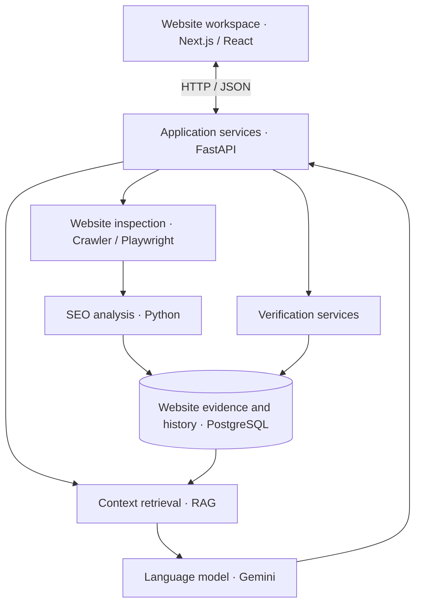

# Aravind Mugappagari

**Product Development | Software Systems | Artificial Intelligence**

I work across product research, system design and AI-assisted software development. My approach is to study how people use existing products, identify problems that remain unresolved, and translate those findings into software requirements, technical decisions and testable solutions.

[LinkedIn](https://www.linkedin.com/in/aravindmugappagari) · [GitHub repositories](https://github.com/aravind9154?tab=repositories)

---

# C O P L I T

**AI-powered SEO intelligence**

### From website diagnostics to informed action.

[Product overview](https://github.com/aravind9154/COPLIT-Portfolio) · [System architecture](https://github.com/aravind9154/COPLIT-Portfolio/blob/main/ARCHITECTURE.md)

### The problem

A website audit can reveal hundreds of technical SEO issues. For a business owner without specialist knowledge, the difficult part is deciding which issues matter, understanding their impact and knowing how to resolve them.

COPLIT is designed around that gap. It connects website inspection, evidence-based explanations, prioritized recommendations and verification within a single workflow.

### A closer look at the experience

Consider a website with missing page headings. Rather than presenting a list of affected URLs alone, COPLIT's approach is to explain the issue, show the affected pages, guide the user towards a correction and inspect the pages again after the change.

| Before a change | After a change |
| :--- | :--- |
| Identify the issue and affected pages. | Inspect the relevant pages again. |
| Explain the finding and recommended action. | Compare the new evidence with the original finding. |
| Help the user decide what to address. | Record the outcome and identify the next priority. |

*Illustrative product workflow.*

---

## Behind the product

The work spans the decisions that shape the user experience and the software required to support it.

**Product decisions** — Studying existing SEO tools, defining user problems, organizing findings and designing the path from diagnosis to resolution.

**Software development** — Designing and working with application interfaces, REST APIs, crawling services, relational data and communication between components.

**AI intelligence** — Designing how language models and retrieval can use website-specific evidence to produce relevant explanations.

**Technical problem-solving** — Investigating request timeouts, error propagation, database behavior and verification workflows through debugging and testing.

### System design

The architecture separates website inspection and rule-based checks from language-model explanations. This allows findings to be tied to collected evidence rather than relying on AI-generated assumptions.

## Explore COPLIT

| Documentation | What you will find |
| :--- | :--- |
| **[Product research & design](https://github.com/aravind9154/COPLIT-Portfolio/blob/main/PRODUCT-CASE-STUDY.md)** | Market problem, user needs, product decisions and experience design |
| **[Software architecture](https://github.com/aravind9154/COPLIT-Portfolio/blob/main/ARCHITECTURE.md)** | Technology choices, API contracts, database relationships, crawling and security |
| **[AI intelligence](https://github.com/aravind9154/COPLIT-Portfolio/blob/main/AI-INTELLIGENCE.md)** | LLMs, Gemini, RAG, context retrieval and evidence-based responses |
| **[Engineering case studies](https://github.com/aravind9154/COPLIT-Portfolio/blob/main/ENGINEERING-CASE-STUDIES.md)** | Technical investigations, debugging, failure handling and verification |
| **[Validation & reliability](https://github.com/aravind9154/COPLIT-Portfolio/blob/main/VALIDATION-AND-LIMITATIONS.md)** | Recorded tests, supported behavior and engineering limitations |

---

## Additional work

**[AI-powered SEO content research](https://github.com/aravind9154/100hires-growth-marketing-task)**

An investigation into how SEO practitioners use AI for content creation, supported by structured research, analysis and Python-based automation.

